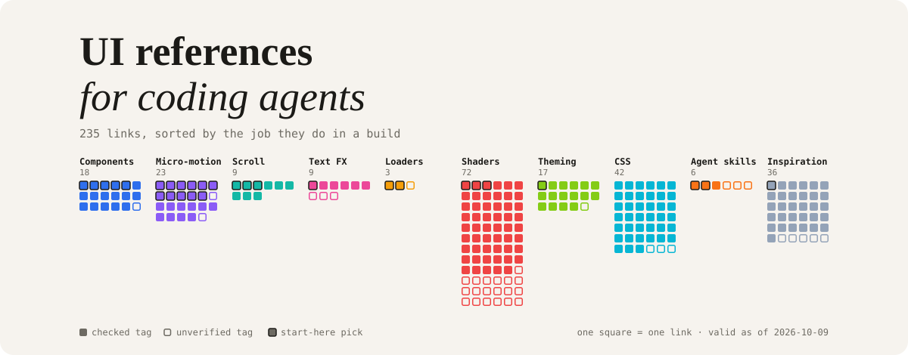

  <picture>
    <source media="(prefers-color-scheme: dark)" srcset="assets/hero-dark.svg">
    
  </picture>

# UI references for coding agents

Component libraries, motion and GSAP resources, shaders, theming tools and agent skills worth handing to a coding agent when you are building interfaces.

It is sorted by **the job a thing does in a build**, not by what kind of resource it is, so you can ask "I'm building a hero section, what do I give my agent?" and get an answer. Collected over years in [Are.na](https://www.are.na) by [closestfriend](https://github.com/closestfriend).

> [!TIP]
> Point an agent at [`llms.txt`](llms.txt) for a compact index, or at [`items.json`](items.json) / [`items.csv`](items.csv) to filter by job. Links marked `llms.txt` or *shadcn registry* are the easiest to hand over: the docs are machine-readable, or the code installs with one command.

> [!NOTE]
> The tags are **automated and only partly hand-checked**. ★ picks were reviewed by hand; links marked _tag unverified_ (hollow squares above) are the tagger's best guess. See [how this was made](#how-this-was-made).

<!-- LIST:START -->
**235 links** · valid as of 2026-10-09 · 30 start-here picks (★)

## Start here

The picks I would hand a coding agent first. Most publish `llms.txt` or a shadcn registry, so an agent can read the docs or install the code directly.

| Pick | Job | Agent-readable | Note |
|---|---|---|---|
| [Graphical](https://www.graphicalui.com/) | Core components & primitives | - | Create visual themes and customize components; built to work with a coding agent. |
| [knadh/oat: Ultra-lightweight, zero dependency, semantic HTML/CSS/JS UI library](https://github.com/knadh/oat) | Core components & primitives | GitHub | Ultra-lightweight, zero-dependency semantic HTML/CSS/JS UI library. |
| [Pixel Perfect UI — Lightweight UI Library for React](https://www.pixel-perfect.space/) | Core components & primitives | shadcn registry | Lightweight React UI library and Framer Motion blocks. |
| [SmolCSS](https://smolcss.dev/) | Core components & primitives | - | Small CSS snippets. |
| [The Component Gallery](https://component.gallery/) | Core components & primitives | - | The Component Gallery: how real design systems name and build components. |
| [Amicro — Premium React Micro-transitions & Interaction Components](https://amicro.vercel.app/) | Micro-interactions & transitions | shadcn registry | React micro-transitions, installable via shadcn registry. |
| [Animation Vocabulary — A Glossary of Animation Patterns](https://animations.samkalok.com/) | Micro-interactions & transitions | `llms.txt` | 91 named animation patterns, for briefing an AI or designer on motion. |
| [apple-design Skill - emilkowalski \| UI Skills](https://www.ui-skills.com/skills/emilkowalski/apple-design) | Micro-interactions & transitions | `llms.txt` | Registry of skills for design engineers, aimed at coding agents. |
| [Fancy Components](https://www.fancycomponents.dev/) | Micro-interactions & transitions | `llms.txt`, shadcn registry | Playful React/TypeScript/Tailwind/Motion components. |
| [Framer Motion Components \| Pixel Perfect UI](https://www.pixel-perfect.space/blocks/motion) | Micro-interactions & transitions | shadcn registry | Lightweight React UI library and Framer Motion blocks. |
| [Interface Craft](https://www.interfacecraft.dev/) | Micro-interactions & transitions | - | Interface Craft, a working library for designing with care. |
| [Motion (formerly Framer Motion)](https://motion.dev/) | Micro-interactions & transitions | `llms.txt` | Motion (formerly Framer Motion): JavaScript and React animation library. |
| [Motionwind — Motion animations as Tailwind classes](https://www.motionwind.xyz/) | Micro-interactions & transitions | `llms.txt` | Motion animations as Tailwind-style utility classes; docs written for LLMs. |
| [Originkit — Free Animated component library for modern websites](https://www.originkit.dev/) | Micro-interactions & transitions | - | Free animated component library. |
| [React UI Components \| ObsidianUI](https://www.obsidianui.dev/components) | Micro-interactions & transitions | `llms.txt`, shadcn registry | React components with full source downloads. |
| [The Vocabulary of Motion](https://motion-vocabulary.vercel.app/) | Micro-interactions & transitions | - | A vocabulary of UI motion terms. |
| [Transitions.dev: UI transitions for AI agents](https://transitions.dev/) | Micro-interactions & transitions | - | UI transitions aimed at AI agents. |
| [GSAP Motion Components for React & Vue \| Annnimate](https://annnimate.com/) | Scroll & page motion | `llms.txt`, paid | GSAP motion components for React and Vue. Paid library. |
| [Lenis – Get smooth or die trying](https://lenis.studiofreight.com/) | Scroll & page motion | - | Lenis: smooth scroll. |
| [The GSAP Field™ — A motion playground by BYQ](https://the-gsap-field.webflow.io/) | Scroll & page motion | - | A GSAP motion playground. |
| [slot-text — tiny text roll animation](https://textmotion.dev/) | Text effects & type motion | - | slot-text: tiny text roll animation. |
| [Generative Loaders — text, inline, and image loaders for React](https://generativeloaders.com/) | Loaders & AI/agent status | - | Text, inline and image loaders for React. |
| [Thinking Orbs - AI Status Indicator Components for React](https://www.thinkingorbs.com/) | Loaders & AI/agent status | `llms.txt` | Animated status orbs for AI agent UIs (thinking, searching, compacting). |
| [Canvas UI: Creative Canvas and WebGL Component Library](https://canvasui.dev/) | Backgrounds, shaders & generative visuals | `llms.txt`, shadcn registry | Canvas/WebGL effect components, framework-agnostic. Ships a shadcn registry. |
| [Paper Shaders – Ultra-fast zero-dependency shaders](https://shaders.paper.design/) | Backgrounds, shaders & generative visuals | `llms.txt` | Zero-dependency shaders for React and GLSL; full docs for LLMs. |
| [Retro Dither \| Canvas UI](https://canvasui.dev/docs/components/retro-dither) | Backgrounds, shaders & generative visuals | `llms.txt`, shadcn registry | Canvas/WebGL effect components, framework-agnostic. Ships a shadcn registry. |
| [tweakcn: themes for shadcn/ui](https://tweakcn.com/) | Theming, color & tokens | shadcn registry | Visual theme editor and generator for shadcn/ui. |
| [emilkowalski/skills](https://github.com/emilkowalski/skills) | Agent skills & motion vocabulary | GitHub | Skills for design engineers, for coding agents. |
| [ibelick/ui-skills](https://github.com/ibelick/ui-skills) | Agent skills & motion vocabulary | GitHub | Skills for design engineers, for coding agents. |
| [DesEngs: Resources for Design Engineers](https://desengs.com/) | Inspiration & reference only | - | Resources for design engineers. |

## Everything, by the job it does

Each link sits under its main job; secondary jobs are noted in parentheses. Open a section to browse.

<b>Core components &amp; primitives</b> (18) — Copy-paste component libraries, UI kits, shadcn-style registries.

- ★ [Graphical](https://www.graphicalui.com/) (also: Theming, color & tokens, Agent skills & motion vocabulary)
- ★ [knadh/oat: Ultra-lightweight, zero dependency, semantic HTML/CSS/JS UI library](https://github.com/knadh/oat) — GitHub
- ★ [Pixel Perfect UI — Lightweight UI Library for React](https://www.pixel-perfect.space/) — shadcn registry
- ★ [SmolCSS](https://smolcss.dev/) (also: Layout & CSS technique)
- ★ [The Component Gallery](https://component.gallery/) (also: Inspiration & reference only)
- [98.css](https://jdan.github.io/98.css/)
- [A useful tool for designing css buttons](https://www.bestcssbuttongenerator.com/)
- [Build your Component Library - shadcn/ui](https://ui.shadcn.com/) — `llms.txt`
- [Craftwork: UX/U kits, templates, vector and 3D illustrations](https://craftwork.design/) — `llms.txt` (also: Inspiration & reference only)
- [CSS Buttons](https://www.w3schools.com/css/css3_buttons.asp)
- [Free UI Resources - Download Best Handpicked Design Resources](https://freeuiresources.com/) (also: Inspiration & reference only)
- [Frend - A collection of accessible, modern front-end components.](https://frend.co/)
- [michu2k/Accordion: Accordion module created in pure javascript & CSS. Very useful to create FAQ lists](https://github.com/michu2k/Accordion) — GitHub
- [React-Select](https://react-select.com/home)
- [Relume Libraries Cloneable](https://relume-libraries.webflow.io/)
- [Storybook: Frontend workshop for UI development](https://storybook.js.org/) — `llms.txt` · _tag unverified_
- [Tailwind CSS button collection - Click-to-copy integration](https://buttons.ibelick.com/)
- [torcado194/scritch-player: A simple, customizable HTML media player designed for artists · GitHub](https://github.com/torcado194/scritch-player) — GitHub

<b>Micro-interactions &amp; transitions</b> (23) — Hover/press/state motion, page transitions, motion libraries.

- ★ [Amicro — Premium React Micro-transitions & Interaction Components](https://amicro.vercel.app/) — shadcn registry
- ★ [Animation Vocabulary — A Glossary of Animation Patterns](https://animations.samkalok.com/) — `llms.txt` (also: Agent skills & motion vocabulary)
- ★ [apple-design Skill - emilkowalski | UI Skills](https://www.ui-skills.com/skills/emilkowalski/apple-design) — `llms.txt` (also: Agent skills & motion vocabulary)
- ★ [Fancy Components](https://www.fancycomponents.dev/) — `llms.txt` · shadcn registry (also: Core components & primitives)
- ★ [Framer Motion Components | Pixel Perfect UI](https://www.pixel-perfect.space/blocks/motion) — shadcn registry (also: Core components & primitives)
- ★ [Interface Craft](https://www.interfacecraft.dev/) — _tag unverified_ (also: Inspiration & reference only)
- ★ [Motion (formerly Framer Motion)](https://motion.dev/) — `llms.txt`
- ★ [Motionwind — Motion animations as Tailwind classes](https://www.motionwind.xyz/) — `llms.txt`
- ★ [Originkit — Free Animated component library for modern websites](https://www.originkit.dev/) (also: Core components & primitives)
- ★ [React UI Components | ObsidianUI](https://www.obsidianui.dev/components) — `llms.txt` · shadcn registry (also: Core components & primitives)
- ★ [The Vocabulary of Motion](https://motion-vocabulary.vercel.app/) (also: Agent skills & motion vocabulary)
- ★ [Transitions.dev: UI transitions for AI agents](https://transitions.dev/) (also: Agent skills & motion vocabulary)
- [60fps - UI/UX animation inspiration for mobile & web apps](https://60fps.design/) — `llms.txt` (also: Inspiration & reference only)
- [90’s Cursor Effects](https://tholman.com/cursor-effects/)
- [Animate.css | A cross-browser library of CSS animations.](https://animate.style)
- [Hover.css - A collection of CSS3 powered hover effects](https://ianlunn.github.io/Hover/)
- [Jitter · A fast and simple motion design tool on the web](https://jitter.video/)
- [LottieFiles for WordPress Plugin: Add Animations to WordPress for Free](https://lottiefiles.com/plugins/wordpress) — `llms.txt` · _tag unverified_
- [Lottielab | Create and Edit Lottie Animations](https://www.lottielab.com/)
- [Make CSS Animations with AI | AI CSS Animations](https://www.aicssanimations.com/)
- [Morphing menu — Playground](https://dannyjpwilliams.com/playground/morphing-menu/) (also: Core components & primitives)
- [Motion](https://motion.zajno.com/) (also: Agent skills & motion vocabulary)
- [UI Movement](https://uimovement.com/) (also: Inspiration & reference only)

<b>Scroll &amp; page motion</b> (9) — Smooth scroll, scroll-driven animation, GSAP choreography.

- ★ [GSAP Motion Components for React & Vue | Annnimate](https://annnimate.com/) — `llms.txt` · paid (also: Micro-interactions & transitions)
- ★ [Lenis – Get smooth or die trying](https://lenis.studiofreight.com/)
- ★ [The GSAP Field™ — A motion playground by BYQ](https://the-gsap-field.webflow.io/)
- [Book rotation on scroll](https://codepen.io/riklomas/pen/dyOBXKy)
- [CSS-only scrollspy effect using scroll-marker-group and :target-current](https://www.sarasoueidan.com/blog/css-scrollspy/) (also: Layout & CSS technique)
- [egstad-construct/detect-scroll](https://github.com/egstad-construct/detect-scroll) — GitHub
- [flackr/scroll-timeline: A polyfill of ScrollTimeline.](https://github.com/flackr/scroll-timeline) — GitHub
- [Scroll-driven Animations](https://scroll-driven-animations.style/)
- [View Progress Timeline: Ranges and Animation Progress Visualizer](https://scroll-driven-animations.style/tools/view-timeline/ranges/)

<b>Text effects &amp; type motion</b> (9) — Animated and kinetic text.

- ★ [slot-text — tiny text roll animation](https://textmotion.dev/)
- [csswarp.eleqtriq.com](https://csswarp.eleqtriq.com/) (also: Layout & CSS technique)
- [Effects Showroom - TerminalTextEffects Docs](https://chrisbuilds.github.io/terminaltexteffects/showroom/)
- [My favourite piece of motion design this week, and its not even animation. 'Pretext' by Cheng Lou hand](https://www.linkedin.com/posts/christian-wheeler-a7b77719a_my-favourite-piece-of-motion-design-this-ugcPost-7447085067245412352-Y543) — _tag unverified_ (also: Inspiration & reference only)
- [rutherfordcraze/variable-animation](https://github.com/rutherfordcraze/variable-animation) — GitHub
- [Studio Blou - Motion Type](https://studioblou.tv/tools/motiontype/) — _tag unverified_
- [Type Dither](https://typedither.vercel.app/) — _tag unverified_ (also: Backgrounds, shaders & generative visuals)
- [Typeface Animator](https://www.typefaceanimator.com/)
- [WordArt](https://codepen.io/kathykato/pen/omxPap) (also: Layout & CSS technique)

<b>Loaders &amp; AI/agent status</b> (3) — Spinners, skeletons, thinking and streaming indicators.

- ★ [Generative Loaders — text, inline, and image loaders for React](https://generativeloaders.com/)
- ★ [Thinking Orbs - AI Status Indicator Components for React](https://www.thinkingorbs.com/) — `llms.txt`
- [Recent — Design Inspiration](https://recent.design/i/vxeptem-orbloom-voice-orb-library) — _tag unverified_ (also: Inspiration & reference only)

<b>Backgrounds, shaders &amp; generative visuals</b> (72) — WebGL, canvas, GLSL, dither, 3D, procedural visuals.

- ★ [Canvas UI: Creative Canvas and WebGL Component Library](https://canvasui.dev/) — `llms.txt` · shadcn registry (also: Core components & primitives)
- ★ [Paper Shaders – Ultra-fast zero-dependency shaders](https://shaders.paper.design/) — `llms.txt`
- ★ [Retro Dither | Canvas UI](https://canvasui.dev/docs/components/retro-dither) — `llms.txt` · shadcn registry
- [*p5.brush - Brush that canvas!](https://p5-brush.cargo.site/)
- [3D Photo Effects free online app](https://3dthis.com/3dfx.htm)
- [aahdee/p5grid: An implementation of triangle, square, hexagon, and octagon grids for p5.js.](https://github.com/aahdee/p5grid) — GitHub
- [ASCII Animation Generator](https://cdn.thefurrow.tv/assets/asciixgpt.html) — _tag unverified_
- [Borelais](https://marlonbarrios.github.io/animated_lines_sound/)
- [ccclaymoji: claymorphism-style SVG emoji maker](https://fffuel.co/ccclaymoji/) — _tag unverified_
- [codepen.io](https://codepen.io/ClementRoche/full/pmvNzq)
- [ColorCycle.js](https://framer.com/m/framer/ColorCycle.js) — `llms.txt` · _tag unverified_
- [Creating a Pencil Effect in SVG](https://heredragonsabound.blogspot.com/2020/02/creating-pencil-effect-in-svg.html) (also: Layout & CSS technique)
- [CSS 3D Clouds](https://www.clicktorelease.com/code/css3dclouds/) (also: Layout & CSS technique)
- [davidsiaw/hexlife](https://github.com/davidsiaw/hexlife) — GitHub
- [Demos — Fabric.js Javascript Canvas Library](http://fabricjs.com/demos/) — _tag unverified_
- [dither in the browser with the power of CSS | maya.land](https://maya.land/monologues/2021/02/15/css-dither.html) (also: Layout & CSS technique)
- [DotForge — Real-Time Dither Animation Builder](https://dotforge.vercel.app/)
- [Dynamic Phyllotaxis 01](https://marlonbarrios.github.io/animated_phylotaxis/)
- [Efecto - Free ASCII Art & Dithering Effects Tool](https://efecto.app/) — `llms.txt`
- [Efecto - Free ASCII Art & Dithering Effects Tool](https://efecto.app/?v=1&in=media&media=%252Fassets%252Fbeach-sunset.mp4&ms=1&mpx=0&mpy=-0.018518518518518545&ss=0&ac=10&gbs=0.2&gdp=0.49&gbo=0&gsp=0.6&pp=pa%3A1%3Anes%2C000000-b53120-6b6b6b-fcfcfc%2C0.7%7Csl%3A1%3A0.3%2C300%7Ccu%3A1%3A0.5%7Cvi%3A1%3A0.4%2C0.7%7Cbc%3A1%3A0.1%2C1.2%2C0%2C1) — `llms.txt`
- [Effect.app — Online Image & Video Effects](https://effect.app/) — _tag unverified_
- [eng.basement.studio](https://eng.basement.studio/tools/shader-lab) — `llms.txt`
- [Explore Effects & Presets | Effect.app](https://effect.app/explore) — _tag unverified_
- [Eyecandy - Visual Technique Library](https://eyecannndy.com/) (also: Inspiration & reference only)
- [Fashion & Style 3D Models](https://sketchfab.com/store/3d-models/fashion-style?animated=1&ref=header) — _tag unverified_
- [free SVG generators, web design tools & modern HTML templates](https://fffuel.co/) (also: Theming, color & tokens)
- [Grainy Gradients | CSS-Tricks](https://css-tricks.com/grainy-gradients/) — `llms.txt` (also: Layout & CSS technique)
- [gwygonik/PerlinRiver](https://github.com/gwygonik/PerlinRiver) — GitHub
- [How We Animated Trillions of Tons of Flowing Ice](http://dwtkns.com/posts/flowing-ice.html) — _tag unverified_
- [HTML Wind Chime System](https://1huali.github.io/windchime/) — _tag unverified_
- [iiisometric: 3D-like isometric design builder](https://fffuel.co/iiisometric/) — _tag unverified_
- [javascript - three js clickable objects - Stack Overflow](https://stackoverflow.com/questions/17638933/three-js-clickable-objects)
- [KOJIMA — Micro-graphic Generator](https://kojima-san.vercel.app/)
- [LingDong-/fishdraw: procedurally generated fish drawings](https://github.com/LingDong-/fishdraw) — GitHub
- [LingDong-/irregularity · GitHub](https://github.com/LingDong-/irregularity) — GitHub · _tag unverified_
- [makew0rld/didder: An extensive, fast, and accurate command-line image dithering tool.](https://github.com/makew0rld/didder) — GitHub · _tag unverified_
- [Megabound/dither-shitter: Tools for dithering](https://github.com/Megabound/dither-shitter?tab=readme-ov-file) — GitHub
- [Motion Playground](https://motion-playground-steel.vercel.app/liquify) — _tag unverified_
- [Moved by Noise (Perlin 101)](https://marlonbarrios.github.io/animated_grid_lines/)
- [Offscreen Canvas](https://offscreencanvas.com/) (also: Inspiration & reference only)
- [photogeniq/neural-texturize](https://github.com/photogeniq/neural-texturize) — GitHub · _tag unverified_
- [Pixelise SVG](https://awesomephant.github.io/pixelise-svg/) — _tag unverified_
- [Placevalue Ascii Playground](https://placevalue-ascii.glitch.me)
- [pppixelate: SVG pixel art pattern maker | fffuel](https://fffuel.co/pppixelate/) — _tag unverified_
- [raphaelameaume/fragment: [alpha] A web development environment for creative coding](https://github.com/raphaelameaume/fragment) — GitHub
- [Reaction diffusion simulation](https://pmneila.github.io/jsexp/grayscott/)
- [Reaction-Diffusion Explorer Tool](https://karlsims.com/rdtool.html?s=WLjznPc5eh7K9008W3)
- [Reaction-Diffusion Explorer Tool](https://karlsims.com/rdtool.html?s=0LWG2)
- [SculptGL - A WebGL sculpting app](https://stephaneginier.com/sculptgl/)
- [SebLague/Slime-Simulation](https://github.com/SebLague/Slime-Simulation) — GitHub
- [Shader lab | Alembic](https://lab.alembic.space/)
- [ShaderGPT](https://shadergpt.14islands.com/)
- [ShaderGPT](https://shadergpt.14islands.com/c902bd8e-7b20-420d-b06f-e99355a908bd)
- [Shaders](https://shaders.com/) — `llms.txt` (also: Core components & primitives)
- [ShprAlex/SproutLife](https://github.com/ShprAlex/SproutLife) — GitHub
- [Simple pencil + ink pen effect for SVG path using filters / Olivia Vane | Observable](https://observablehq.com/@oliviafvane/simple-pencil-ink-pen-effect-for-svg-path-using-filters) (also: Layout & CSS technique)
- [Spherium | Advanced WebGL Globe & Map Generator](https://tryspherium.com/)
- [Strings](https://codepen.io/shubniggurath/pen/ZYpjorm)
- [SVG Filters](https://yoksel.github.io/svg-filters/) (also: Layout & CSS technique)
- [texturedesign/texturize: 🤖🖌️ Generate photo-realistic textures based on source images. Remix, remake,](https://github.com/texturedesign/texturize) — GitHub · _tag unverified_
- [Texturelib - free texture library](http://texturelib.com/) — _tag unverified_
- [Three.js – JavaScript 3D library](https://threejs.org/) — `llms.txt`
- [Topographic Map Animation](https://codepen.io/jonyablonski/pen/BpxzrO)
- [tsulej/GenerateMe](https://github.com/tsulej/GenerateMe) — GitHub
- [unicorn.studio — No-code WebGL Tool](https://www.unicorn.studio/) — `llms.txt`
- [urbit/sigil-js: ~4.2 billion default profile pics](https://github.com/urbit/sigil-js) — GitHub
- [Vector Halftone Maker - Interactive PNG/SVG halftone pattern generator](https://halftone.xoihazard.com/)
- [Vector Halftone Maker - Interactive PNG/SVG halftone pattern generator](https://xoihazard.com/tools/halftone/)
- [Vite + React](https://solst-ice.github.io/pxl-srt/) — _tag unverified_
- [WebGL flower](https://www.ibiblio.org/e-notes/Splines/garden/lathe/tulip_tex.htm)
- [WebGL Fluid Simulation](https://paveldogreat.github.io/WebGL-Fluid-Simulation/)
- [www.shadertoy.com](https://www.shadertoy.com/)

<b>Theming, color &amp; tokens</b> (17) — Color systems, theme editors, gradient and shadow generators.

- ★ [tweakcn: themes for shadcn/ui](https://tweakcn.com/) — shadcn registry
- [~ soft aesthetic ~](https://github.com/soft-aesthetic) — GitHub · _tag unverified_
- [antiflasher/apcach: JS color calculator for composing colors with consistent APCA contrast ratio.](https://github.com/antiflasher/apcach) — GitHub
- [Color Scales | Components AI](https://components.ai/color-scale/0XJLbb2fwjM6LzK2pmLQ)
- [Colors – Radix UI](https://www.radix-ui.com/colors)
- [CSS Gradient Generator](https://www.joshwcomeau.com/gradient-generator/)
- [CSS Shadow Palette Generator](https://www.joshwcomeau.com/shadow-palette/)
- [d3/d3-scale-chromatic](https://github.com/d3/d3-scale-chromatic) — GitHub
- [Esri Color Ramps | ArcGIS Maps SDK for JavaScript](https://developers.arcgis.com/javascript/latest/visualization/symbols-color-ramps/esri-color-ramps/)
- [evilmartians/harmony: Harmony color palette](https://github.com/evilmartians/harmony) — GitHub
- [FOUND COLOR schemes for web and UI](https://foundcolor.co/)
- [Instrument — Mapping Dominant Image Colors in Javascript](https://www.instrument.com/articles/mapping-colors)
- [larsenwork/postcss-easing-gradients](https://github.com/larsenwork/postcss-easing-gradients) — GitHub
- [mattdesl/dictionary-of-colour-combinations: palettes from A Dictionary of Colour Combinations](https://github.com/mattdesl/dictionary-of-colour-combinations) — GitHub
- [Neumorphism CSS shadow generator](https://neumorphism.io/)
- [texel-org/color: modern color library for image processing and creative coding (oklab, xyz, p3, rec20](https://github.com/texel-org/color) — GitHub
- [ZoeFiri/base16-summercamp](https://github.com/ZoeFiri/base16-summercamp) — GitHub

<b>Layout &amp; CSS technique</b> (42) — Modern CSS, HTML and SVG references and techniques.

- [<named-color> CSS type - CSS | MDN](https://developer.mozilla.org/en-US/docs/Web/CSS/Reference/Values/named-color)
- [🤯 HEAD - A simple guide to HTML <head> elements](https://htmlhead.dev/)
- [AndreasFaust/awesome-styled-components: A curated list of awesome styled-components resources 💅](https://github.com/AndreasFaust/awesome-styled-components) — GitHub · _tag unverified_
- [Antiquated HTML Snippets and Artefacts | Vale.Rocks](https://vale.rocks/posts/html-relics)
- [attr() - CSS | MDN](https://developer.mozilla.org/en-US/docs/Web/CSS/attr)
- [Basscss](http://basscss.com/)
- [Border-image generator - CSS: Cascading Style Sheets | MDN](https://developer.mozilla.org/en-US/docs/Web/CSS/CSS_Backgrounds_and_Borders/Border-image_generator)
- [Carousel · Intro to CSS 3D transforms](https://3dtransforms.desandro.com/carousel)
- [Clippy — CSS clip-path maker](https://bennettfeely.com/clippy/)
- [cohost!](https://cohost.org/-12/post/240461-svg-animate-attribu) — _tag unverified_
- [Conditional Border Radius In CSS - Ahmad Shadeed](https://ishadeed.com/article/conditional-border-radius/)
- [CSS GUI — Visual styling controls for the web](https://components.ai/css-gui)
- [CSS Layout Generator](https://layout.bradwoods.io/)
- [css list filtering](https://hack.wesleyac.com/pokemon.html)
- [CSS Masonry & CSS Grid | CSS-Tricks](https://css-tricks.com/css-masonry-css-grid/) — `llms.txt`
- [CSS Nuggets | CodyHouse](https://codyhouse.co/nuggets/)
- [CSS Tools: Reset CSS](https://meyerweb.com/eric/tools/css/reset/)
- [CVS Receipt](https://codepen.io/garrettbear/full/JzMmqg)
- [Emoji Cursor - CSS Generator Tool](https://www.emojicursor.app/)
- [Grid Garden - A game for learning CSS grid](https://cssgridgarden.com/)
- [hteumeuleu/email-bugs](https://github.com/hteumeuleu/email-bugs) — GitHub
- [joshbuchea/HEAD: A simple guide to HTML <head> elements](https://github.com/joshbuchea/HEAD) — GitHub
- [mask-image - CSS: Cascading Style Sheets | MDN](https://developer.mozilla.org/en-US/docs/Web/CSS/mask-image)
- [Modern fluid typography editor](https://modern-fluid-typography.vercel.app/)
- [My current HTML boilerplate](https://www.matuzo.at/blog/html-boilerplate/) — `llms.txt`
- [New CSS that can actually be used in 2024](https://thomasorus.com/new-css-that-can-actually-be-used-in-2024.html)
- [New CSS that can actually be used in 2024 - Thomasorus](https://thomasorus.com/new-css-that-can-actually-be-used-in-2024)
- [Print-CSS – SELFHTML-Wiki](https://wiki.selfhtml.org/wiki/Print-CSS)
- [Printing - Developer guides | MDN](https://developer.mozilla.org/en-US/docs/Web/Guide/Printing)
- [sdras/cssgridgenerator: 🧮 Generate basic CSS Grid code to make dynamic layouts!](https://github.com/sdras/cssgridgenerator) — GitHub
- [Selecting previous siblings with CSS :has()](https://tobiasahlin.com/blog/previous-sibling-css-has/)
- [size - CSS: Cascading Style Sheets | MDN](https://developer.mozilla.org/en-US/docs/Web/CSS/@page/size)
- [Style a parent element based on its number of children using CSS :has()](https://www.bram.us/2022/11/17/style-a-parent-element-based-on-its-number-of-children-using-css-has/)
- [SVG Path Visualizer](https://svg-path-visualizer.netlify.app/)
- [SVGOMG](https://jakearchibald.github.io/svgomg/)
- [The Lost CSS Tricks of Cohost.org | CSS-Tricks](https://css-tricks.com/the-lost-css-tricks-of-cohost-org/) — `llms.txt`
- [The Mine: No JS, CSS only adventure game](https://codepen.io/jcoulterdesign/pen/NOMeEb) — _tag unverified_
- [The Ultimate CSS Shapes Collection](https://css-shape.com/)
- [Tufte CSS](https://edwardtufte.github.io/tufte-css/)
- [unicode-range | CSS-Tricks](https://css-tricks.com/almanac/properties/u/unicode-range/) — `llms.txt`
- [WTF, HTML and CSS?](http://wtfhtmlcss.com/)
- [You no longer need JavaScript Ʊ lyra's epic blog](https://lyra.horse/blog/2025/08/you-dont-need-js/)

<b>Agent skills &amp; motion vocabulary</b> (6) — Skill files for coding agents; glossaries for briefing an AI about motion.

- ★ [emilkowalski/skills](https://github.com/emilkowalski/skills) — GitHub
- ★ [ibelick/ui-skills](https://github.com/ibelick/ui-skills) — GitHub
- [dmarx/luria: A simple but effective project memory framework based on change management principles. Luria trac](https://github.com/dmarx/luria) — GitHub · _tag unverified_
- [langgptai/awesome-claude-prompts: This repo includes Claude prompt curation to use Claude better.](https://github.com/langgptai/awesome-claude-prompts) — GitHub · _tag unverified_
- [latentwill/ideonomy-skill: A Claude Code skill for expanding ideas via Patrick Gunkel's ideonomy, synthesized](https://github.com/latentwill/ideonomy-skill) — GitHub · _tag unverified_
- [staltz/microskills: Modular prompts I use every day](https://github.com/staltz/microskills) — GitHub

<b>Inspiration &amp; reference only</b> (36) — Galleries and showcases. Nothing to install; useful for taste.

- ★ [DesEngs: Resources for Design Engineers](https://desengs.com/)
- [9.63](https://ninepointsixthree.co/)
- [A creative agency based in Aotearoa.](https://motionsickness.co.nz/)
- [All Inspiration Components](https://www.tilebit.io/all-inspirations) — `llms.txt`
- [Browse iOS Apps | Mobbin - The world’s largest mobile app design reference library](https://mobbin.com/browse/ios/apps) — `llms.txt`
- [Capital Theme - Berlin - Ecommerce Website Template](https://themes.shopify.com/themes/capital/styles/berlin?surface_detail=capital&surface_inter_position=1&surface_intra_position=1&surface_type=search)
- [Catalogue — every Arqé template | Arqé](https://arqe.ai/catalogue) — `llms.txt` · _tag unverified_
- [CodePen](https://codepen.io/) — _tag unverified_
- [Codrops | Keeping web professionals inspired & up-to-date since 2009](https://tympanus.net/codrops/)
- [Creative Hub | Codrops](https://tympanus.net/codrops/hub/)
- [Deck.Gallery® — Beautifully designed decks, curated](https://www.deck.gallery/) — `llms.txt`
- [Denys Verholomchuk UI/UX Designer & Mentor](https://verholomchuk.com/)
- [Design Systems](https://designsystems.surf/design-systems)
- [Design Systems Database: Surf among top‑notch Design Systems](https://designsystems.surf/)
- [Discover iOS apps | Mobbin](https://mobbin.com/discover/apps/ios/latest) — `llms.txt`
- [Dusk — Elegant & Premium Framer Portfolio Template](https://dusk-template.framer.website/)
- [Dynamic Motion Templates – Bold, Engaging Design Projects – 6TM® MAGAZINE](https://shop.6tm-magazine.com/collections/motion) — `llms.txt` · _tag unverified_
- [Elliot Vredenburg Promotional Website](https://ellio.tv/)
- [ena supply - Framer Templates & Resources](https://ena.supply/)
- [Envy Theme - Gothenburg - Ecommerce Website Template](https://themes.shopify.com/themes/envy/styles/gothenburg)
- [everestpipkin/tools-list](https://github.com/everestpipkin/tools-list) — GitHub · _tag unverified_
- [EverythingMoves is a creative studio based in London specialising in CGI, motion design, and live action direc](https://everythingmoves.com/)
- [Flow Theme - Queenstown - Ecommerce Website Template](https://themes.shopify.com/themes/flow/styles/queenstown?surface_detail=flow&surface_inter_position=1&surface_intra_position=1&surface_type=search)
- [Infinite Canvas app gallery](https://infinitecanvas.tools/gallery/)
- [Interface In Game | Collection of video games UI | Screenshots and videos](https://interfaceingame.com/)
- [INTL Playground](https://playground.intl.international/01/)
- [Logo Inspiration — 1,300+ Logos & Animated Logos | Logosystem](https://logosystem.co/) — `llms.txt`
- [Malavika's Notes](https://malavikainmotion.com/) — _tag unverified_
- [Payflow IO: Free AI Website Template by Mita — Framer Marketplace](https://www.framer.com/community/marketplace/templates/payflow-io/) — `llms.txt`
- [Playground Archives | Codrops](http://tympanus.net/codrops/category/playground/)
- [Prand - animated world](https://prand-n.ava-case.com/)
- [Recent — Design Inspiration](https://recent.design/)
- [tidal-motion-ecosystem](https://vucko.co/project/tidal-motion-ecosystem)
- [Tutorials | Codrops](https://tympanus.net/codrops/category/tutorials/)
- [UI Garage - Specific UI Design inspiration & Pattern for your design.](https://uigarage.net/)
- [wrmdrks | Wordmark library](https://wrdmrks.com/)

## Credits

Most of these links were found through other people's public [Are.na](https://www.are.na) channels. If this list is useful to you, their channels are worth following:

- Sam Dal Monte: [code-4wc6tn_-iko](https://www.are.na/sam-dal-monte/code-4wc6tn_-iko) (37)
- Shanik Tanna: [resources-ivu1-39tfyg](https://www.are.na/shanik-tanna/resources-ivu1-39tfyg) (37)
- kim kleinert: [resources-tools-s_fl46656mg](https://www.are.na/kim-kleinert/resources-tools-s_fl46656mg) (23)
- sinco institute Ⓢ: [expensive-ui-0xxh6b-nbjm](https://www.are.na/sinco-institute/expensive-ui-0xxh6b-nbjm) (17)
- Everest Pipkin: [the-browser-is-already-a-game-engine-2026](https://www.are.na/everest-pipkin/the-browser-is-already-a-game-engine-2026) (16)
- Kirill Kuznetsov: [resources-veogmafl1lg](https://www.are.na/kirill-kuznetsov/resources-veogmafl1lg) (16)
- Edeline Go: [rs001-design-resources](https://www.are.na/edeline-go/rs001-design-resources) (14)
- claire r: [tools-toys-vg9uiwetfsw](https://www.are.na/claire-r/tools-toys-vg9uiwetfsw) (11)
- Dmytro Horeniuk: [web-tools-odb4oktvfdk](https://www.are.na/dmytro-horeniuk/web-tools-odb4oktvfdk) (10)
- Rachel Steele: [tools-for-creating](https://www.are.na/rachel-steele/tools-for-creating) (10)
- bill stellar: [tools-resources-qrd5bmyvd_0](https://www.are.na/bill-stellar/tools-resources-qrd5bmyvd_0) (8)
- Nikita Cheremin: [beautiful-web-ukkly1taacg](https://www.are.na/nikita-cheremin/beautiful-web-ukkly1taacg) (7)
- New Name: [interesting-tools-dgn1vah3udc](https://www.are.na/new-name/interesting-tools-dgn1vah3udc) (6)
- Samuel Platten: [system-design-z4qqdexy9oi](https://www.are.na/samuel-platten/system-design-z4qqdexy9oi) (6)
- BOEM LE HACHOIR: [web-design-c5jm7slhsfg](https://www.are.na/boem-le-hachoir/web-design-c5jm7slhsfg) (4)
- Chelsi Cocking: [creative-coding-library](https://www.are.na/chelsi-cocking/creative-coding-library) (4)
- Marlon Barrios Solano: [form-motion-studies-apps](https://www.are.na/marlon-barrios-solano/form-motion-studies-apps) (3)
- S HSB: [design-resources-references-ur-zxgjqycm](https://www.are.na/s-hsb/design-resources-references-ur-zxgjqycm) (3)
- Sean McSherry🌯: [re-source-design](https://www.are.na/sean-mcsherry/re-source-design) (3)
- cucumber  salad: [design-libraries-resources-and-tools](https://www.are.na/cucumber-salad/design-libraries-resources-and-tools) (2)
- Dominik VD: [tools-_w-nwn_y3qs](https://www.are.na/dominik-vd/tools-_w-nwn_y3qs) (2)
- Tyler Deitz: [using-github-in-interesting-ways](https://www.are.na/tyler-deitz/using-github-in-interesting-ways) (2)
- Abby Bingham: [motion-2nsdiwsvrfw](https://www.are.na/abby-bingham-rjxgktgn48y/motion-2nsdiwsvrfw) (1)
- Cade "Shibco" Diehm: [open-source-design-resources](https://www.are.na/cade-shibco-diehm/open-source-design-resources) (1)
- Erwin Sanvictores: [motion_design_ideas](https://www.are.na/erwin-sanvictores/motion_design_ideas) (1)
- H H: [motion-theory-2u0v4x09fai](https://www.are.na/h-h-zm4jg7s0ybg/motion-theory-2u0v4x09fai) (1)
- Levi Barrenechea: [tools-4l6tvdajyoq](https://www.are.na/levi-barrenechea/tools-4l6tvdajyoq) (1)
- marina lua: [digital-toolbox](https://www.are.na/marina-lua/digital-toolbox) (1)
- Tim Jungmann: [www-draggable](https://www.are.na/tim-jungmann/www-draggable) (1)
<!-- LIST:END -->

## How this was made

- Candidates were picked from saved Are.na links by keyword, then tagged by an LLM from each link's title, URL and description, and re-checked against the live page text where the first guess was low-confidence. Neither pass reads the code of a project, so "a good library" is my judgement, not a test result.
- The ★ start-here picks were checked by hand.
- `llms.txt` / shadcn-registry detection means a real file was fetched from the site root on the date above. "Not found" does not mean there are no docs.
- Dead, parked and hijacked domains were removed at check time (2026-10-09). Links rot; if you hit one, open an issue or a PR.
- The README list, `llms.txt`, `items.json` and the hero image are all generated from [`items.csv`](items.csv) by [`scripts/build.mjs`](scripts/build.mjs). Edit the CSV, not the generated files.

## Contributing

See [CONTRIBUTING.md](CONTRIBUTING.md). Short version: add a row to `items.csv`; a GitHub Action rebuilds everything else.

## License

[CC0 1.0](LICENSE): the list is links and short labels, free to reuse. All linked projects belong to their authors.
